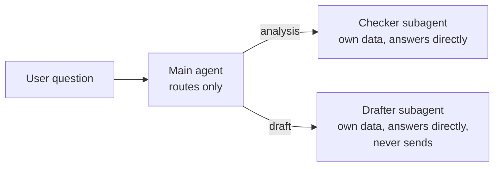

# SAP BW agents

No-code AI agent designs for SAP BW teams. Each one comes with ready-to-paste instructions for a main agent and its subagents, a flow diagram, the questions it answers, the data it needs, and a POC success bar.

Each agent is designed as a one-week proof of concept: build it without code in Google's Workflow Builder (formerly Agent Designer) or any agent builder that supports subagents, test it against cases your team has already resolved, and decide whether it's worth a pilot.

| Agent | When | Problem it solves | What it returns |
| --- | --- | --- | --- |
| [BW Load Triage Assistant](bw-load-triage/) | Every morning | Manual review of overnight process chain failures, and business users finding stale reports first. **Start here.** | Failed, late and warning chains with likely cause, standard fix and affected reports; draft business updates |
| [DST Readiness Checker](dst-readiness-check/) | A week before each daylight saving change | Manual schedule review to find chains, jobs and deltas at risk when clocks change | Checklist of items to act on before and check after; draft change notices |

## The pattern behind every agent

- **The main agent only routes.** In Workflow Builder, a subagent takes over the conversation and answers the user directly; it doesn't report back. So each request goes to one subagent that can answer it fully, with its own copy of the data.
- **One status per item,** from a short fixed list, so results can be scored against an answer key.
- **Evidence for every finding,** with the source row.
- **No guessing.** Unknown errors are reported as "not in the runbook"; missing data as "needs information".
- **Read-only.** The agents diagnose and draft. People restart, reschedule and send.

The BW Load Triage Assistant was tested end to end: see its [test results](bw-load-triage/#test-results).

## How to build one in Workflow Builder

Steps as tested in Gemini Enterprise, Business edition, November 2026:

1. In the left sidebar, click **+ New agent**, then **Build manually**.
2. Click the **My Agent** node and paste the name, description and instructions from the agent's `main-agent.md`. Under **Connectors**, remove **Google Search**.
3. Click the **+** on the bottom edge of the main agent node to add a subagent. Paste its file from `subagents/`, upload the data files to its **Knowledge**, and remove Google Search. Repeat from the main agent node for the second subagent.
4. Test in **Preview**, starting a new chat for each question. **Show thinking** reveals which subagent took the request.
5. Click **Create**.

Download the raw CSV files (or clone the repo). Saving the GitHub web page gives you an HTML file, not the data. There is no SAP connector for Workflow Builder in Google's recent release notes, so these designs use exports, which is enough for a POC.

## Before you use real data

- **Sharing an agent shares its data.** Anyone you share it with can ask about everything in its data sources, including error messages and system names.
- **Keep it inside your company's account.** Use your organization's Gemini Enterprise, not a personal one, for real BW data.
- **Use your own runbook and rules.** The agents only suggest the standard actions your team has written down.

## License

MIT
