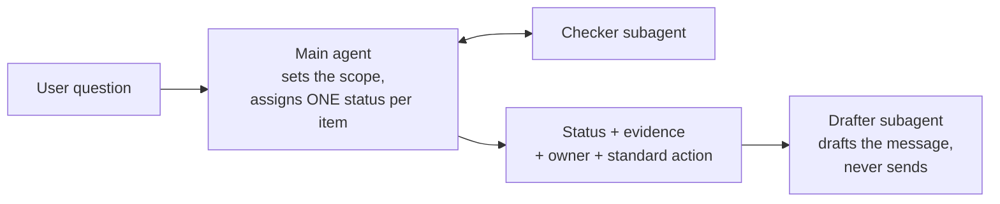

# SAP BW agents

No-code AI agent designs for SAP BW teams. Each one comes with ready-to-paste instructions for a main agent and its subagents, a flow diagram, the questions it answers, the data it needs, and a POC success bar.

Each agent is designed as a one-week proof of concept: build it without code in Google's Workflow Builder (formerly Agent Designer) or any agent builder that supports subagents, test it against cases your team has already resolved, and decide whether it's worth a pilot.

| Agent | When | Problem it solves | What it returns |
| --- | --- | --- | --- |
| [BW Load Triage Assistant](bw-load-triage/) | Every morning | Manual review of overnight process chain failures, and business users finding stale reports first. **Start here.** | Failed, late and warning chains with likely cause, standard fix and affected reports; draft business updates |
| [DST Readiness Checker](dst-readiness-check/) | A week before each daylight saving change | Manual schedule review to find chains, jobs and deltas at risk when clocks change | Checklist of items to act on before and check after; draft change notices |

## The pattern behind every agent

- **One status per item,** from a short fixed list, so results can be scored against an answer key.
- **Evidence for every finding,** with the source row.
- **No guessing.** Unknown errors are reported as "not in the runbook"; missing data as "needs information".
- **Read-only.** The agents diagnose and draft. People restart, reschedule and send.

## How to build one in Workflow Builder

1. In the Gemini Enterprise web app, click **+ Create agent**, then **Chat agent**, then **Proceed to builder**.
2. Click the **My Agent** node and paste the name, description and instructions from the agent's `main-agent.md`. Choose a **Model**.
3. Click **Add data sources & tools** to attach the data listed in the agent's README, as Google Sheets in a shared drive your admin has connected.
4. Under **Knowledge**, click **Add files** to upload the runbook or team rules.
5. On the **Flow** tab, hover over the main agent, click **Add subagent**, and paste each file from `subagents/`.
6. Test in **Preview**, then click **Create** and share with a small pilot group.

Labels follow Google's documentation as of October 2026. Your admin must turn on Workflow Builder for your web app. There is no SAP connector for Workflow Builder in Google's recent release notes, so these designs use spreadsheet exports, which is enough for a POC.

## Before you use real data

- **Sharing an agent shares its data.** Anyone you share it with can ask about everything in its data sources, including error messages and system names.
- **Keep it inside your company's account.** Use your organization's Gemini Enterprise, not a personal one, for real BW data.
- **Use your own runbook and rules.** The agents only suggest the standard actions your team has written down.

## License

MIT
