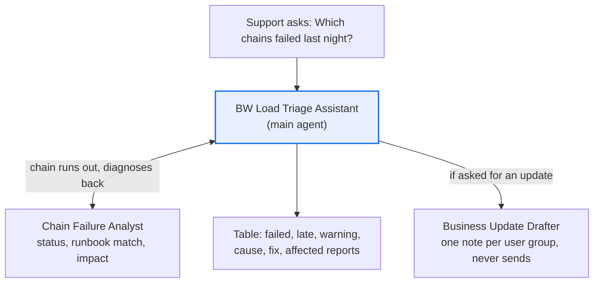

# BW Load Triage Assistant

**Process:** SAP BW support (daily operations)

**Start here.** Every morning, the BW support team opens the process chain monitor, scans last night's runs for failures, works out each cause, checks the runbook, and figures out which reports now show stale data, while "Why is my dashboard empty?" emails arrive. This agent does that first pass in seconds and drafts the update to business users.

It's read-only: it never restarts a chain or changes anything in the system.

**POC question:** can an agent diagnose overnight load failures accurately enough that the support team stops doing the morning check by hand?

## Design

| Agent | Role |
| --- | --- |
| [BW Load Triage Assistant](main-agent.md) | Sets the scope, gets diagnoses, shows what needs attention |
| [Chain Failure Analyst](subagents/1-chain-failure-analyst.md) | Classifies each run, matches errors to the runbook, finds affected reports |
| [Business Update Drafter](subagents/2-business-update-drafter.md) | Drafts one plain-language update per user group |

## Questions it answers

- Which process chains failed or ran late last night?
- Why did the sales data load fail, and what's the fix?
- Which reports and dashboards are showing stale data this morning, and who uses them?
- Has this chain failed with the same error before this month?
- Draft a status update to the finance users about the delayed margin report.

## Data it needs

| Data | Columns | Typical source | Add as |
| --- | --- | --- | --- |
| Chain run log | Chain ID, chain description, process type, variant, start time, end time, status, error message | Export from the process chain monitor or your BW monitoring report | Data source (Sheet) |
| Chain schedule | Chain ID, expected finish time | Your BW scheduling documentation | Data source (Sheet) |
| Report impact map | Chain ID, dependent reports and dashboards, business owner, user group | BW documentation, or built once by the team | Data source (Sheet) |
| Runbook | Known errors, likely cause, standard fix, owner, when to escalate | Your BW support team | Knowledge (doc) |

Refresh the run log every morning during the pilot. Run logs can contain system names and data values in error messages: keep the pilot inside your company's own Gemini Enterprise account, and share the agent only with people who already have access to the BW monitor.

## Try it with sample data

[`sample-data/`](sample-data/) has a fictional dataset: three nights of runs for 11 process chains, covering every status, including an error that isn't in the runbook. It includes the three spreadsheets, a sample runbook to upload as Knowledge, an [answer key](sample-data/answer_key.csv), and a [test script](sample-data/TESTING.md) with nine questions and their correct answers.

To load it: in Google Drive, upload each CSV and open it with Google Sheets. Then attach the three sheets in **Add data sources & tools**.

## POC success bar

Use the run logs from 10 nights last month, including nights that caused incident tickets. The tickets are your answer key.

| Check | Bar |
| --- | --- |
| Failed and late chains found | 100% |
| Likely cause matches the incident ticket | At least 80% |
| Unknown errors reported as "not in the runbook" instead of guessed | Every time |
| Affected reports listed correctly | Every chain checked |
| Time for the morning check | At least half |
