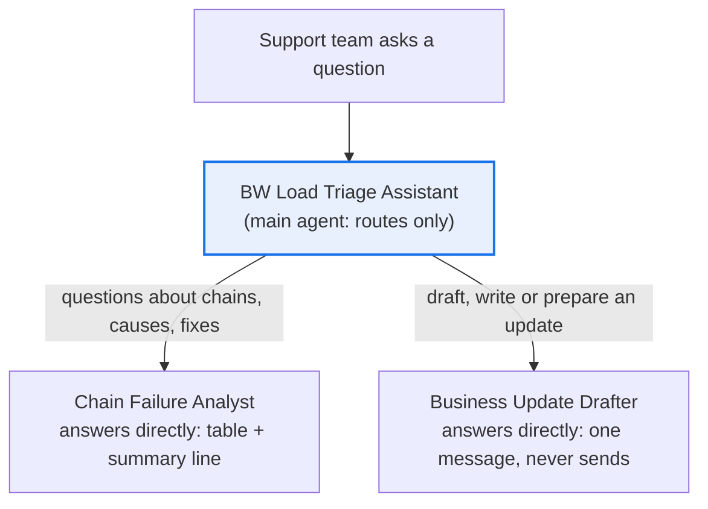

# BW Load Triage Assistant

**Process:** SAP BW support (daily operations)

**Start here.** Every morning, the BW support team opens the process chain monitor, scans last night's runs for failures, works out each cause, checks the runbook, and figures out which reports now show stale data, while "Why is my dashboard empty?" emails arrive. This agent does that first pass in seconds and drafts the update to business users.

It's read-only: it never restarts a chain or changes anything in the system.

**POC question:** can an agent diagnose overnight load failures accurately enough that the support team stops doing the morning check by hand?

## Design

| Agent | Role |
| --- | --- |
| [BW Load Triage Assistant](main-agent.md) | Routes each request to the right subagent |
| [Chain Failure Analyst](subagents/1-chain-failure-analyst.md) | Classifies each run, matches errors to the runbook, finds affected reports, answers the user |
| [Business Update Drafter](subagents/2-business-update-drafter.md) | Drafts one plain-language update per user group from its own copy of the data |

**Why this shape:** in Workflow Builder, a subagent **takes over the conversation** and answers the user directly; it doesn't report back to the main agent. So the main agent routes, and each subagent has everything it needs to answer alone. An earlier design that passed facts from the analyst to the drafter never reached the drafter. See [Test results](#test-results).

## Questions it answers

- Which process chains failed or ran late last night?
- Why did the sales data load fail, and what's the fix?
- Which reports and dashboards are showing stale data this morning, and who uses them?
- Has this chain failed with the same error before this month?
- Draft a status update to the finance users about the delayed margin report.

## Data it needs

| Data | Columns | Typical source | Add as |
| --- | --- | --- | --- |
| Chain run log | Chain ID, chain description, process type, variant, start time, end time, status, error message | Export from the process chain monitor or your BW monitoring report | Knowledge file (CSV) |
| Chain schedule | Chain ID, expected finish time | Your BW scheduling documentation | Knowledge file (CSV) |
| Report impact map | Chain ID, dependent reports and dashboards, business owner, user group | BW documentation, or built once by the team | Knowledge file (CSV) |
| Runbook | Known errors, likely cause, standard fix, owner, when to escalate | Your BW support team | Knowledge file |

Upload all four files to **both** subagents' Knowledge. Refresh the run log every morning during the pilot. Run logs can contain system names and data values in error messages: keep the pilot inside your company's own Gemini Enterprise account, and share the agent only with people who already have access to the BW monitor.

## Try it with sample data

[`sample-data/`](sample-data/) has a fictional dataset: three nights of runs for 11 process chains, covering every status, including an error that isn't in the runbook. It includes the three spreadsheets, a sample runbook to upload as Knowledge, an [answer key](sample-data/answer_key.csv), and a [test script](sample-data/TESTING.md) with nine questions and their correct answers.

Upload the three CSVs and `runbook.md` directly to each subagent's **Knowledge**. Download the raw files (or clone the repo); saving the GitHub web page gives you an HTML file instead of the CSV.

## Build it (Gemini Enterprise, Business edition, November 2026)

1. In the left sidebar, click **+ New agent**, then **Build manually**.
2. Click the **My Agent** node. Paste the name, description and instructions from [`main-agent.md`](main-agent.md). Under **Connectors**, remove **Google Search**. Add the starter prompts.
3. Click the **+** on the bottom edge of the main agent node to add a subagent. Paste [Chain Failure Analyst](subagents/1-chain-failure-analyst.md), upload the four files to its **Knowledge**, and remove Google Search.
4. Click the main agent node again and use its **+** to add the second subagent. Paste [Business Update Drafter](subagents/2-business-update-drafter.md), upload the same four files, and remove Google Search.
5. Test in the **Preview** tab, starting a new chat for each test question. Open **Show thinking** to see which subagent the request was transferred to.
6. Click **Create**.

## Test results

Tested on the sample data with the [test script](sample-data/TESTING.md), using Gemini 3.8 Flash for all three agents. It took 7 runs and 4 changes to pass every test.

| Run | Result | Change made |
| --- | --- | --- |
| 1 | All 8 chains and the "not in the runbook" trap correct. Invented fixes for 3 late and warning chains; no summary line | Tightened the main agent's instructions |
| 2 | Still one invented fix; successful chains listed | Noticed the table had the subagent's columns: the subagent's answer was reaching the user directly. Moved the rules into the subagent |
| 3 | Invented fixes gone; stale-report count correct. **Regression:** the runbook's escalation rule was dropped | Made escalation explicit; moved sort order and summary sentence into the subagent |
| 4 | Overview correct; unknown error not guessed even when asked "how do we fix it?"; successful chain explained correctly | None |
| 5–6 | Draft requests returned the analyst's table, even when the drafter was named | The thinking panel showed "Transfer To Agent": subagents take over instead of reporting back. Redesigned: main agent routes only; drafter gets its own data |
| 7 | Correct draft for sales users, routed straight to the drafter. Earlier tests still pass | None |

Lessons:
1. **Fix the agent that produces the behavior.** The answer came from the subagent, so editing the main agent changed little.
2. **Rerun every test after every change.** Removing invented advice also removed a rule that was in the runbook.
3. **Subagents take over the conversation.** Design for one subagent per request, each with its own data.

## Public demo link

Workflow Builder agents can only be shared inside your organization. To share a link with anyone, rebuild the agent as a Gemini Gem: see [`gemini-gem/`](gemini-gem/).

## Code version (ADK)

For a public demo link, exact counts computed in Python, and a path to live BW data, see the [ADK version](adk/).

## POC success bar

Use the run logs from 10 nights last month, including nights that caused incident tickets. The tickets are your answer key.

| Check | Bar |
| --- | --- |
| Failed and late chains found | 100% |
| Likely cause matches the incident ticket | At least 80% |
| Unknown errors reported as "not in the runbook" instead of guessed | Every time |
| Affected reports listed correctly | Every chain checked |
| Time for the morning check | At least half |
