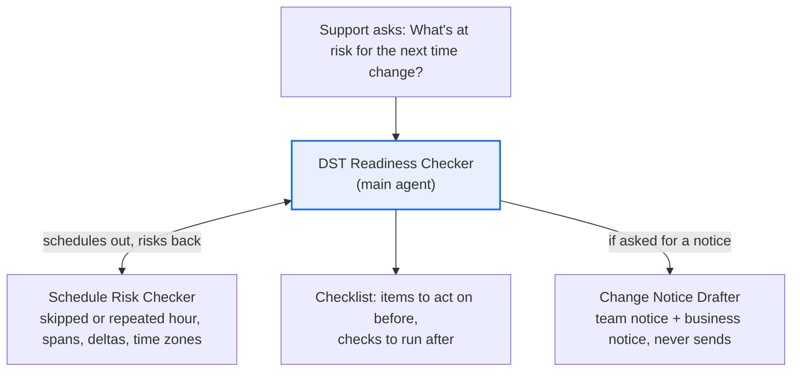

# DST Readiness Checker

**Process:** SAP BW support (seasonal)

Twice a year, clocks change. When they spring forward, an hour is skipped; when they fall back, an hour repeats. Depending on how your system and jobs are set up, chains scheduled in that hour can be skipped, run twice or start late, and deltas based on local-time timestamps can miss or duplicate records. Landscapes that span regions have a second problem: the US and Europe change on different dates, so for a few weeks the gap between systems isn't what schedules assume.

This agent does the pre-change schedule review a week ahead and drafts the change notices. It's read-only: it never reschedules or holds anything.

**POC question:** can an agent find every chain, job and delta at risk from a time change, so the team's review takes minutes instead of hours?

## Design

| Agent | Role |
| --- | --- |
| [DST Readiness Checker](main-agent.md) | Finds the next change, gets the risks, builds the checklist |
| [Schedule Risk Checker](subagents/1-schedule-risk-checker.md) | Checks each chain, job and delta load against the change |
| [Change Notice Drafter](subagents/2-change-notice-drafter.md) | Drafts the notice for the BW team and for business users |

## Questions it answers

- What's at risk for the next time change?
- Which chains run in the skipped hour on March 14, 2027?
- Which delta loads rely on local-time timestamps?
- Which source systems change on a different date from BW, and what does that do to our load timing?
- Draft the change notice for the BW team and business users.

## Data it needs

| Data | Columns | Typical source | Add as |
| --- | --- | --- | --- |
| Chain and job schedule | Chain or job ID, description, start time, typical duration, frequency, time zone | BW scheduling documentation or job overview export | Data source (Sheet) |
| Delta loads | DataSource, source system, delta method, whether its timestamp is local time or UTC, safety interval | BW documentation | Data source (Sheet) |
| Source systems | System, time zone, region | Landscape documentation | Data source (Sheet) |
| Time change calendar and team rules | Upcoming change dates by region, the affected hour, standard actions (hold, reschedule, verify after) | Your BW team | Knowledge (doc) |

The next changes are March 14, 2027 in the US and March 28, 2027 in the EU. Add the dates for every region your landscape covers. Check your SAP release's own guidance on time changes when writing the team rules.

## POC success bar

Use the schedule as it stood before the last time change, and compare the agent's list with what actually needed attention.

| Check | Bar |
| --- | --- |
| Chains and jobs in or across the affected hour found | 100% |
| Local-time timestamp deltas found | 100% |
| Objects with missing data listed as "needs information" instead of guessed | Every time |
| Time for the pre-change review | At least half |
